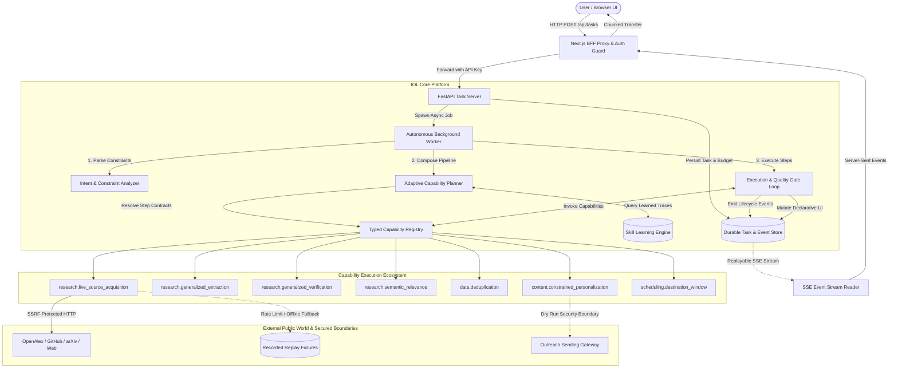

# IOL — Technical Architecture Specification

**Product:** Intent Operating Layer (IOL)  
**Version:** 0.5.0-MVP (Engineers' Conclave Edition)  
**Governing Product Principles:**  
1. **Primary:** Execute the user's requested work and deliver usable, verified outcomes.  
2. **Secondary:** Learn generalizable capabilities from execution so related future tasks become faster and more reliable across users without leaking private information.  

---

## 1. High-Level Architectural Overview

The Intent Operating Layer is an autonomous execution platform that compiles natural-language user intent into dynamically composed, verifiable capability pipelines. Execution runs out-of-band in persistent background workers, streaming durable events and declarative UI updates to the browser.

---

## 2. Core Architectural Subsystems

### 2.1 Intent & Constraint Analysis (`IntentConstraints`)
Natural language intents are parsed into declarative execution contracts rather than raw strings:
- **`entity_category`**: Target domain classification (`academic_faculty`, `ai_startup`, `ai_developer_framework`).
- **`mandatory_inclusion_criteria`**: Non-negotiable conditions candidates must satisfy with explicit provenance.
- **`exclusion_criteria`**: Immediate disqualifiers (e.g. recruitment repos, student homework, non-AI marketing agencies, geographic violations).
- **`requested_attributes`**: Schema target fields (e.g. `institution`, `license`, `location`).
- **`geographic_restrictions` & `temporal_restrictions`**: Bounding filters (e.g. India headquarters, founded 2021+).
- **`requested_record_count`**: Cardinality goals (e.g. 5 or 10 records).

### 2.2 Adaptive Capability Planner (`AdaptiveCapabilityPlanner`)
Generates DAG execution plans by matching intent contracts against capability definitions:
- **Dynamic Selection**: Discards hardcoded workflows. Academic faculty and Indian startups execute through identical reusable capabilities.
- **Quality Gate Insertion**: Automatically injects `research.semantic_relevance` and `data.deduplication` before outcome presentation.
- **Selective Outreach Boundary**: Omits outreach drafting and email scheduling unless explicitly requested by the user.
- **Warm-Start Optimization**: Matches incoming intents against successful historical traces in `SkillLearningEngine`, compiling plans in `< 15ms`.

### 2.3 Typed Capability Registry (`CapabilityRegistry`)
Provides a decoupled execution boundary for modular capabilities:
- **Contract Enforcement**: Every capability declares typed Pydantic `input_model` and `output_model`.
- **Runtime Validation**: Inputs and outputs are validated before and after invocation; violations fail the step deterministically.
- **Permission Boundaries**: Capabilities declare required permissions (e.g. `NETWORK_ACCESS`, `OUTREACH_DISPATCH`).
- **Dynamic Parameter Resolution**: Resolves output-to-input JSON paths (e.g. `step_extraction.records` -> `step_verification.records`).

### 2.4 Durable Task Store & Event Sourcing (`DurableTaskStore`)
- **Storage Engines**: Local durable SQLite in Write-Ahead-Logging (WAL) mode for local development; PostgreSQL for production.
- **Event Sourcing**: Every lifecycle state change, capability invocation, UI mutation, and error is stored as an immutable event with monotonic IDs.
- **Resilience**: Client disconnections or server reboots do not affect background worker execution.

### 2.5 Autonomous Background Worker (`BackgroundWorker`)
- Executes asynchronously without browser tab dependency.
- Enforces budget constraints (step count, elapsed time, USD cost, retry limit).
- Catches cancellations reactively between pipeline steps.
- Handles retries with exponential backoff on transient capability failures.

### 2.6 Declarative UI Protocol (`DeclarativeUIRoot`)
Decouples backend business logic from frontend layout:
- The backend emits structured UI components (`TableComponent`, `TimelineComponent`, `CardComponent`, `ComparisonComponent`).
- The frontend renders components dynamically using a clean Next.js/Tailwind registry.
- Features include live progress meters, sortable table columns, inline badges, and an interactive slide-out Evidence Drawer.

### 2.7 Authenticated SSE Streaming & BFF Proxy
- **BFF Route Proxy** (`frontend/src/app/api/[...path]/route.ts`): Masks backend endpoints, injects proxy bypasses, and relays headers.
- **Authenticated Fetch-Based SSE Reader**: Native browser `EventSource` cannot send custom HTTP headers (`X-API-Key`). IOL implements an authenticated `fetch()` stream with `ReadableStreamDefaultReader`.
- **Durable Event Replay**: Passes `Last-Event-ID` header upon reconnect; the backend replays missed events from the database before resuming live streaming.

---

## 3. Security, Boundaries & Multi-Tenant Isolation

| Layer | Security Mechanism | Threat Addressed |
| :--- | :--- | :--- |
| **API Authentication** | Constant-time `X-API-Key` validation via `APIKeyAuthenticator` | Unauthorized API access, brute-force timing attacks |
| **Multi-Tenant Ownership** | Strict `user_id` & `tenant_id` ownership verification | Cross-tenant data leakage, unauthorized task cancellation |
| **Network Egress (SSRF)** | IP address validation blocking private/loopback RFC-1918 ranges | Server-Side Request Forgery against internal cloud services |
| **Input Sanitization** | HTML entity stripping and non-printable control char filtering | Stored XSS injection from external scraped web pages |
| **Outreach Dispatch Gateway** | Hard-enforced `dry_run=True` sandbox mode | Accidental or unapproved automated email dispatches |
| **Evidence Semantics** | Conservative confidence cap (0.88 max) | Overconfident hallucinated certainty claims |

---

## 4. Capability Catalog (11 Registered Capabilities)

1. `research.live_source_acquisition`: Live HTTP/API search across OpenAlex, GitHub, and web directories with SSRF protection and cryptographic hashing.
2. `research.generalized_extraction`: Dynamic schema extraction mapping raw source metadata to user-specified attributes.
3. `research.generalized_verification`: Field-level evidence verification with URL validation, source quotes, and calibrated confidence scoring.
4. `research.semantic_relevance`: Constraint gate validating domain inclusion criteria, temporal bounds, geographic location, and hard exclusions.
5. `data.deduplication`: Multi-field cryptographic deduplication using SHA-256 composite identity keys.
6. `research.entity_discovery`: Outreach Engine adapter capability for researcher discovery.
7. `research.structured_extraction`: Outreach Engine adapter for tabular schema standardization.
8. `research.verification`: Outreach Engine adapter for email and URL verification.
9. `data.deduplication` (adapter): Outreach Engine composite deduplication.
10. `content.constrained_personalization`: Outreach Engine 4-paragraph personalized message generator.
11. `scheduling.destination_window`: Outreach Engine timezone and DST-aware 8:00 AM destination delivery calculator.
